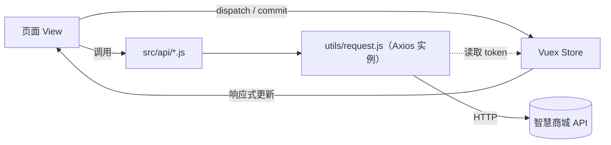

# 智慧商城 · Shopping


> 一个基于 **Vue 2 + Vant 2** 的移动端商城 H5 项目。覆盖「浏览 → 搜索 → 商品详情 → 加购 → 结算 → 下单 → 订单管理」的完整电商主流程，适合作为 Vue 全家桶的实战练习或课程设计参考。

---

## 目录

- [项目简介](#项目简介)
- [技术栈](#技术栈)
- [功能清单](#功能清单)
- [接口说明](#接口说明)
- [快速开始](#快速开始)
- [目录结构](#目录结构)
- [页面与路由](#页面与路由)
- [核心实现](#核心实现)
- [接口清单](#接口清单)
- [可优化点 / TODO](#可优化点--todo)
- [声明](#声明)

---

## 项目简介

「智慧商城」是一个面向手机端的商城前端项目，按 375px 设计稿开发，使用 `postcss-px-to-viewport` 自动转换为 `vw` 实现多端自适应。项目以一个「移动端电商 App」的形态组织页面：底部 TabBar 承载首页、分类、购物车、我的四个一级页面，其余页面（登录、搜索、商品详情、结算、订单）以独立路由跳转。

项目重点实践了以下能力：

- Axios 实例封装与请求/响应拦截器（统一 loading、token 注入、错误提示）
- Vue Router 动态路由传参 + 全局前置守卫做页面级鉴权
- Vuex 模块化状态管理（`user` / `cart`），购物车选中态与金额计算的 getter 派生
- Vant 组件按需引入与 `babel-plugin-import` 按需打包
- 登录后回跳（`backUrl`）、未登录操作拦截（mixin 复用确认弹窗）
- Less + `vw` 适配 + 移动端常见布局（固定底栏、吸顶头部、左右分栏滚动）

---

## 技术栈

| 分类 | 技术 | 说明 |
| --- | --- | --- |
| 视图框架 | Vue 2.6 | Options API 开发 |
| 路由 | Vue Router 3.5 | 动态路由 `/prodetail/:id`、全局前置守卫 |
| 状态管理 | Vuex 3.6 | `user`、`cart` 两个命名空间模块 |
| UI 组件库 | Vant 2.13 | 按需引入（`src/utils/vant-ui.js`） |
| 网络请求 | Axios 1.x | 自定义实例 + 拦截器封装 |
| 样式 | Less | 全局样式 `src/styles/common.less` |
| 移动端适配 | postcss-px-to-viewport | 设计稿宽度 375px，自动转 `vw` |
| 代码规范 | ESLint（`@vue/standard`） | `npm run lint` 校验 |
| 脚手架 | @vue/cli 5 | Babel、ESLint、Router、Vuex 插件 |

---

## 功能清单

- [x] **首页**：顶部搜索栏、轮播图、金刚区图标、活动 Banner、"猜你喜欢"商品流
- [x] **分类页**：左侧一级分类、右侧二级分类宫格，点击联动切换
- [x] **搜索**：搜索历史本地持久化（去重 + 置顶）、一键清空、搜索结果列表
- [x] **商品详情**：图片轮播与自定义指示器、价格/销量、用户评价与星级、富文本图文详情
- [x] **加入购物车 / 立即购买**：底部操作弹层、数量步进器、库存校验，未登录时弹窗引导登录
- [x] **购物车**：单选 / 全选、数量增减、编辑态批量删除、实时合计、空购物车占位、去结算
- [x] **订单结算**：收货地址、商品清单、金额明细、余额支付方式、提交订单
- [x] **我的订单**：全部 / 待支付 / 待发货 / 待收货 / 待评价 五个 Tab 切换
- [x] **个人中心**：用户信息、账户余额、订单快捷入口、我的服务宫格、退出登录
- [x] **登录**：图形验证码 + 短信验证码登录、60 秒倒计时、登录成功回跳原页面
- [x] **路由鉴权**：`/pay`、`/myorder` 未登录自动跳转登录页

---

## 接口说明

所有请求统一走 `src/utils/request.js` 中创建的 Axios 实例：

```js
const instance = axios.create({
  baseURL: 'http://smart-shop.itheima.net/index.php?s=/api',
  timeout: 5000
})
```

- 接口来源：黑马程序员「智慧商城」公开测试环境，**仅供学习使用**。
- 若接口失效或跨域受限，可自行搭建 Mock，或修改 `baseURL` / `vue.config.js` 中的代理配置。
- `vue.config.js` 中另预留了 `/api` 代理规则，可把请求改为 `/api/xxx` 走本地代理转发。
- 已登录时，请求头会自动携带 `Access-Token` 与 `platform: H5`。

---

## 快速开始

**环境要求**：Node.js >= 14（推荐 16 / 18），npm >= 6。

```bash
# 1. 安装依赖
npm install

# 2. 本地开发（默认 http://localhost:8080）
npm run serve

# 3. 生产构建，产物输出到 dist/
npm run build

# 4. 代码检查与自动修复
npm run lint
```

> 仓库内的 `.npmrc` 已配置 `legacy-peer-deps=true`，避免 Vue 2 与 Vant 2 依赖树解析冲突。

**登录测试**：项目使用手机号 + 短信验证码登录。接口注释中提供的测试凭据为手机号 `15751776629`、验证码 `246810`；若测试环境调整，以接口实际返回为准。

---

## 目录结构

```
shopping
├── public/
│   ├── favicon.ico
│   └── index.html               # HTML 模板
├── src/
│   ├── api/                    # 接口层，按业务域拆分
│   │   ├── address.js          # 收货地址
│   │   ├── cart.js             # 购物车增删改查
│   │   ├── category.js         # 分类
│   │   ├── home.js             # 首页聚合数据
│   │   ├── login.js            # 图形/短信验证码、登录
│   │   ├── order.js            # 结算确认、提交订单、订单列表
│   │   ├── product.js          # 商品列表/详情/评价
│   │   └── user.js             # 用户信息
│   ├── assets/                 # 图片、iconfont 字体图标
│   ├── components/
│   │   ├── CountBox.vue        # 数量步进器（v-model）
│   │   ├── goodsItem.vue       # 商品卡片
│   │   └── OrderListItem.vue   # 订单列表项
│   ├── mixins/
│   │   └── loginConfirm.js     # 未登录拦截 + 登录回跳
│   ├── router/
│   │   └── index.js            # 路由表 + 全局前置守卫
│   ├── store/
│   │   ├── index.js            # 根 store
│   │   └── modules/
│   │       ├── user.js         # 用户信息 / 退出登录
│   │       └── cart.js         # 购物车列表、选中态、合计
│   ├── styles/
│   │   └── common.less         # 样式重置与公共类
│   ├── utils/
│   │   ├── request.js          # Axios 实例与拦截器
│   │   ├── storage.js          # localStorage 读写封装
│   │   └── vant-ui.js          # Vant 按需注册
│   ├── views/
│   │   ├── layout/             # 一级页面（带 TabBar）
│   │   │   ├── index.vue       # TabBar 布局容器
│   │   │   ├── home.vue        # 首页
│   │   │   ├── category.vue    # 分类
│   │   │   ├── cart.vue        # 购物车
│   │   │   └── user.vue        # 我的
│   │   ├── login/index.vue     # 登录
│   │   ├── search/             # 搜索入口 + 结果列表
│   │   ├── prodetail/index.vue # 商品详情
│   │   ├── pay/index.vue       # 订单结算
│   │   └── myorder/index.vue   # 我的订单
│   ├── App.vue
│   └── main.js                 # 入口：注册路由、Vuex、全局样式、Vant
├── .eslintrc.js
├── babel.config.js             # Vant 按需引入插件
├── jsconfig.json               # @ 别名与编辑器提示
├── postcss.config.js           # px → vw 适配
├── vue.config.js               # publicPath、devServer 代理
└── package.json
```

---

## 页面与路由

| 路径 | 组件 | 页面说明 | 需登录 |
| --- | --- | :--- | :---: |
| `/login` | `views/login/index.vue` | 手机号 + 验证码登录 | ✗ |
| `/` | `views/layout/index.vue` | TabBar 布局容器，重定向到 `/home` | ✗ |
| `/home` | `views/layout/home.vue` | 首页 | ✗ |
| `/category` | `views/layout/category.vue` | 分类页 | ✗ |
| `/cart` | `views/layout/cart.vue` | 购物车 | ✗（未登录展示空态） |
| `/user` | `views/layout/user.vue` | 个人中心 | ✗ |
| `/search` | `views/search/index.vue` | 搜索入口 + 历史记录 | ✗ |
| `/searchlist` | `views/search/list.vue` | 搜索结果 / 分类商品列表 | ✗ |
| `/prodetail/:id` | `views/prodetail/index.vue` | 商品详情（动态路由参数） | ✗ |
| `/pay` | `views/pay/index.vue` | 订单结算 | ✓ |
| `/myorder` | `views/myorder/index.vue` | 我的订单 | ✓ |

鉴权逻辑位于 `src/router/index.js`：

```js
const authUrl = ['/pay', '/myorder']

router.beforeEach((to, from, next) => {
  // 非权限页面直接放行
  if (!authUrl.includes(to.path)) {
    return next()
  }
  // 权限页面校验 token
  const token = store.getters.token
  if (token) {
    next()
  } else {
    next('/login')
  }
})
```

---

## 核心实现

### 1. Axios 封装（`src/utils/request.js`）

- 通过 `axios.create` 创建独立实例，不污染全局默认配置。
- **请求拦截**：开启全局 `Toast.loading`（`duration: 0`，禁止背景点击，防止重复提交），并在有 token 时注入请求头。
- **响应拦截**：统一解包 `response.data`，按业务 `status` 判断成功与否；成功关闭 loading，失败 `Toast` 提示并 `reject`，让调用方仍可用 `try/catch` 或 `.catch` 处理。

```js
const res = response.data
if (res.status !== 200) {
  Toast(res.message)
  return Promise.reject(res.message)
}
Toast.clear()
return res
```

### 2. 登录态与本地持久化

- 用户信息（`token`、`userId`）保存在 Vuex `user` 模块，并同步写入 `localStorage`（键名 `hm_shopping_info`），刷新页面后由 `getInfo()` 恢复。
- 图形验证码接口返回 `{ base64, key }`，图片用于展示，`key` 随短信验证码请求一起提交。
- 登录成功后读取 `route.query.backUrl` 并用 `router.replace` 回跳，避免登录页残留在历史栈中。
- 退出登录通过 `user/logout` action 同时重置用户信息与购物车（跨模块提交 `root: true`）。

### 3. 购物车状态（`src/store/modules/cart.js`）

接口返回的购物车数据不含「是否选中」字段，因此在 `getCartAction` 中为每条记录补一个 `ischecked` 标记，并以此派生以下 getter：

| getter | 作用 |
| --- | --- |
| `cartTotal` | 购物车内商品总件数 |
| `selCartList` | 已选中的商品项 |
| `selCount` | 已选中商品件数 |
| `selPrice` | 已选中商品总价（保留两位小数） |
| `isALLChecked` | 是否全选 |

数量修改采用「先改本地、再同步后台」的策略：先 `commit` 更新视图，再调用 `/cart/update` 持久化，保证操作手感流畅。

### 4. 未登录拦截 mixin（`src/mixins/loginConfirm.js`）

商品详情页的「加入购物车」「立即购买」共用 `loginConfrim()`：无 token 时弹出 `Dialog` 确认框，用户选择「去登录」则携带当前 `fullPath` 作为 `backUrl` 跳转登录页，并返回 `true` 供调用方提前终止后续请求。

### 5. 组件按需引入与移动端适配

- `src/utils/vant-ui.js` 集中 `Vue.use()` 所需的 Vant 组件，`babel.config.js` 中配合 `babel-plugin-import` 实现样式按需加载。
- `postcss.config.js` 将 375px 设计稿下的 `px` 自动换算为 `vw`，一份样式适配不同屏宽。
- 公共样式（样式重置、两行省略、导航栏配色）统一沉淀在 `src/styles/common.less`。

### 6. 数据流转



---

## 接口清单

| 方法 | 路径 | 说明 | 封装文件 |
| --- | --- | --- | --- |
| GET | `/captcha/image` | 获取图形验证码 | `api/login.js` |
| POST | `/captcha/sendSmsCaptcha` | 发送短信验证码 | `api/login.js` |
| POST | `/passport/login` | 手机号验证码登录 | `api/login.js` |
| GET | `/page/detail` | 首页聚合数据（轮播/导航/推荐） | `api/home.js` |
| GET | `/category/list` | 分类列表 | `api/category.js` |
| GET | `/goods/list` | 商品列表（分类 / 关键词 / 分页） | `api/product.js` |
| GET | `/goods/detail` | 商品详情 | `api/product.js` |
| GET | `/comment/listRows` | 商品评价列表 | `api/product.js` |
| POST | `/cart/add` | 加入购物车 | `api/cart.js` |
| GET | `/cart/list` | 购物车列表 | `api/cart.js` |
| POST | `/cart/update` | 修改购物车数量 | `api/cart.js` |
| POST | `/cart/clear` | 删除购物车商品 | `api/cart.js` |
| GET | `/address/list` | 收货地址列表 | `api/address.js` |
| GET | `/checkout/order` | 订单结算确认 | `api/order.js` |
| POST | `/checkout/submit` | 提交订单 | `api/order.js` |
| GET | `/order/list` | 我的订单列表 | `api/order.js` |
| GET | `/user/info` | 用户信息 | `api/user.js` |

---

## 声明

- 本项目为个人学习作品，商品数据与后端接口来自黑马程序员「智慧商城」公开课程资料，**仅供学习交流，请勿用于商业用途**。
- 图片、字体等素材版权归原作者所有，如涉侵权请联系删除。
